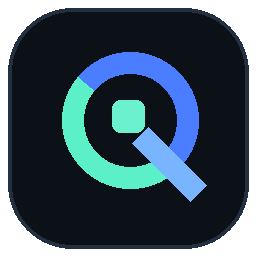
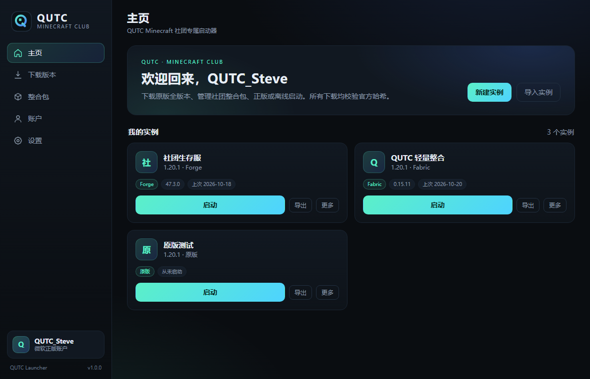

# QUTC Launcher

QUTC Minecraft 社团内部使用的 Minecraft 启动器。Windows 桌面端，Electron + 原生 JavaScript，无第三方运行时依赖。



## 界面



更多界面预览见 `docs/`：版本下载、实例创建、账户、设置、MOD 下载。

## 功能

- **原版全版本下载**：读取 Mojang 官方 `version_manifest_v2.json`，正式版、快照、远古版本均可安装；客户端、依赖库、资源、日志配置逐文件校验 SHA-1。
- **正版登录**：微软 OAuth 2.0 设备码流程（Microsoft → Xbox Live → XSTS → Minecraft Services）。不在启动器里输入密码，`refresh_token` 使用 Windows DPAPI（Electron `safeStorage`）加密保存。
- **第三方外置登录**：支持任意 HTTPS Yggdrasil / authlib-injector 验证服务器，内置 LittleSkin 快捷设置；自动下载并校验 `authlib-injector`（SHA-256）。支持把第三方网站的一键登录按钮拖入启动器，自动识别 API 地址（ALI）。密码只发送给所选验证服务器，不保存；accessToken 加密保存。
- **离线模式**：按 Minecraft 规则生成稳定离线 UUID，适合社团内服/局域网。
- **加载器**：Fabric、Quilt（官方 meta JSON，直接写入版本目录）；Forge、NeoForge（官方安装器，必须显式同意，优先校验官方 SHA-1）。
- **实例导入 / 导出**：`.qutc` 包，包含 `mods/`、`config/`、`saves/` 等；导入前检查路径穿越、符号链接、压缩炸弹。
- **整合包**：从 Modrinth 搜索并安装 `.mrpack`，支持本地 `.mrpack` 导入；按 `modrinth.index.json` 下载并校验 SHA-1。
- **MOD 下载**：选择实例后从 Modrinth 搜索 MOD，按实例的 MC 版本与加载器过滤；安装到实例 `mods/`，自动安装 required 依赖，校验 SHA-1，并在更新时清理同一 MOD 的旧版本。
- **中文名 / 双语搜索**：内置常见 MOD 中文别名（钠、物品管理器、光影、机械动力等），会同时搜索中文关键词和对应英文名；也提供 MC百科 / MINEBBS 外链搜索和本地 jar 导入。
- **QUTC 品牌界面**：简洁深色 UI，主页实例卡片、版本库、整合包、MOD、账户、设置六个页面。
- **便携数据目录**：默认 `QUTCData/` 与启动器同目录，复制整个目录即可备份/迁移。

## 运行

### 直接运行（推荐）

**不要直接双击工作区里的 `dist/QUTC-Launcher/QUTC Launcher.exe`**。本项目的 DSH 工作区（`大肥鱼工作区`）对 Chromium 子进程有限制，直接运行会无反应或闪退（Windows 事件日志为 `0xc0000005`）。把运行时安装到普通用户目录即可：

```powershell
node scripts/install-local.js
```

脚本会复制到 `%LOCALAPPDATA%\QUTC-Launcher`，并在桌面创建「QUTC Launcher」快捷方式。以后双击桌面快捷方式即可，数据保存在该目录的 `QUTCData/`。项目根目录也生成了 `QUTC Launcher 快捷方式.lnk`。

也可以双击 `run.cmd`：它会把 `vendor/electron` 复制到 `%LOCALAPPDATA%\QUTC-Launcher\runtime`，再启动工作区中的源码。

如果你拿到的是 `dist/QUTC-Launcher-1.0.0-win-x64.zip`，请解压到普通目录（例如 `C:\QUTC\`）后再双击 `QUTC Launcher.exe`，不要放在工作区/沙箱目录内。

如果终端环境设置了 `ELECTRON_RUN_AS_NODE=1`，`run.cmd` 会清除；手动运行 `electron.exe` 前需要：

```powershell
Remove-Item Env:ELECTRON_RUN_AS_NODE
```

### 开发

需要 Node.js 18+（仅用于脚本，启动器本身不依赖 Node 包）：

```bash
node scripts/test.js        # 核心单元测试
node scripts/start.js       # 使用 vendor/electron 启动
node scripts/package-win.js # 生成 dist/QUTC-Launcher 便携版
```

Electron 运行时位于 `vendor/electron/`。若缺失，从 npmmirror 下载 `electron-v31.7.7-win32-x64.zip` 并解压到该目录：

<https://npmmirror.com/mirrors/electron/31.7.7/electron-v31.7.7-win32-x64.zip>

### 测试

```bash
node scripts/test.js            # 28 项核心单元测试（安全/哈希/ZIP/Maven/整合包/MOD/LittleSkin）
node scripts/smoke-ipc.js       # 主进程 IPC 冒烟（不启动 GUI，会访问 Mojang/Fabric/Modrinth）
node scripts/smoke-auth.js      # 微软登录链离线 mock（设备码 → XBL → XSTS → MC → 档案 → 刷新）
node scripts/smoke-yggdrasil.js # authlib-injector 登录链离线 mock（ALI/认证/刷新/拖拽 URI）
node scripts/smoke-authlib.js   # 真实下载 authlib-injector 并校验 SHA-256
node scripts/smoke-instance.js  # 实例导出/导入 + 恶意 versionId 拦截
node scripts/smoke-install.js 1.20.1 official   # 真实安装 1.20.1（约 650MB）
node scripts/smoke-loader.js <QUTCData 路径> fabric
node scripts/smoke-modpack.js <QUTCData 路径>   # 真实 Modrinth .mrpack 安装（Sodium）
node scripts/smoke-mod.js                       # 真实 MOD 搜索、依赖安装、SHA-1、本地导入
node scripts/smoke-ui-mods.js                   # 真实 Electron 界面：中文搜索 + 安装 + LittleSkin 表单
node scripts/preview-ui.js shot-home.png home   # 用 Edge headless 生成 UI 预览图
```

`smoke-install.js` 的第三个参数可指定镜像（`official` / `bmclapi`），第四个参数可复用已有数据目录：

```bash
node scripts/smoke-install.js 1.20.1 official "C:\path\to\QUTCData"
```

## 正版登录配置（必须由管理员完成一次）

微软设备码登录需要一个 Azure 应用 Client ID，启动器不内置任何公共 Client ID。

1. 打开 <https://portal.azure.com> → Microsoft Entra ID → 应用注册 → 新注册。
2. 名称填 `QUTC Launcher`，账户类型选「仅此组织目录中的账户」或「任何组织目录中的账户和个人 Microsoft 账户」。
3. 重定向 URI 选「公共客户端/本机」→ `http://localhost`（设备码流程不使用它，但注册时需要）。
4. 在「身份验证」中启用 **允许公共客户端流**。
5. 复制「应用程序(客户端) ID」，填入启动器「设置 → 正版登录 → Microsoft OAuth Client ID」并保存。
6. 在「账户」页点击「开始正版登录」，按提示在浏览器输入设备码。

详细原理与常见错误见 `SECURITY.md`。

## authlib-injector 外置登录

账户页支持任意 authlib-injector / Yggdrasil 验证服务器，不需要 Azure 配置：

1. 在「验证服务器 API 地址」填写完整地址（例如 `https://littleskin.cn/api/yggdrasil`），或点击「使用 LittleSkin」。
2. 也可以从第三方网站把「一键登录」按钮**拖进启动器**。拖拽数据格式为：
   `authlib-injector:yggdrasil-server:<encodeURIComponent(apiRoot)>`
   启动器会按 authlib-injector 规范读取 `X-Authlib-Injector-API-Location` 和 `meta.serverName`，填入服务器地址；如果该服务器已有登录过的账号，会直接切换过去。
3. 输入该服务器的账号、密码，点「登录外置账号」。
4. 密码只发送给该验证服务器，不写磁盘；登录成功后保存加密 accessToken。
5. 启动游戏时会自动下载 `authlib-injector`（校验 SHA-256），注入 `-javaagent`，加载角色/皮肤并完成外置服务器鉴权。

注意：外置登录**不能进入正版服务器**，只能进入配置了同一外置登录的服务器。只在你信任的验证服务器输入密码；HTTP 地址会被拒绝。

## 数据目录

```
QUTCData/
├─ config.json          启动器配置
├─ accounts.json        账号（refresh_token 已加密）
├─ versions/            版本 JSON 与客户端 jar
├─ libraries/           Maven 依赖
├─ assets/              游戏资源（objects/indexes）
├─ java/                Mojang 官方 Java 运行时（按需下载）
├─ instances/           实例（gameDir + natives）
├─ cache/               版本清单、下载缓存
└─ logs/                launcher.log 与游戏日志
```

## 已知限制

- 仅 Windows 优先支持（自动下载 Java 运行时仅 Windows）。macOS/Linux 需手动指定 Java。
- CurseForge 整合包未内置：其 API 需要私钥，不适合公开内置；当前只支持 Modrinth `.mrpack`。
- NeoForge Maven 在部分网络不可达；启动器会自动尝试 QLU 镜像下载安装器，但安装器自身仍可能联网失败（会显示日志）。
- 没有自动更新；社团内分发新版本时替换整个便携目录即可。
- 微软登录依赖 Azure 应用配置；未配置时离线模式仍可正常使用。
- LittleSkin 外置登录依赖 LittleSkin 服务本身；外置登录无法进入正版服务器，皮肤/鉴权由 authlib-injector 处理。
- **MINEBBS / MC百科没有公开、稳定的 MOD 下载 API**：启动器不会抓取它们的页面或附件，只提供搜索外链；下载后的 jar 可用「导入本地 MOD」加入实例。

## 项目结构

```
src/core/           纯 Node 核心（无 Electron 依赖，可单测）
  http.js           HTTPS 下载、镜像、重试、哈希校验
  zip.js            自研 ZIP 读写（防穿越/炸弹/符号链接）
  versions.js       版本清单、继承合并、安装
  assets.js         资源与旧版 virtual/resources 映射
  java.js           Java 检测与 Mojang 官方运行时安装
  launch.js         启动参数构建、natives 解压、游戏进程
  loaders.js        Fabric/Quilt/Forge/NeoForge
  modrinth.js       Modrinth API（整合包 / MOD 搜索）
  modpack.js        .mrpack 安装
  mods.js           MOD 下载、依赖解析、mods 目录与旧版本清理
  mod-aliases.js    中文 MOD 名 → 英文搜索词
  authlib.js        authlib-injector 下载与 SHA-256 校验
  instances.js      .qutc 导入/导出
  auth/             微软设备码、LittleSkin Yggdrasil、离线账号、加密存储
src/main/           Electron 主进程、IPC 白名单、preload
src/renderer/       无框架 UI（index.html / styles.css / app.js）
scripts/            测试、图标、启动、打包
```

## 安全

- 渲染进程 `sandbox` + `contextIsolation` + 无 Node 权限；只通过白名单 IPC 调用主进程。
- 禁止页面导航与 `window.open`；外链只允许白名单域名。
- 下载只允许 HTTPS 公网地址；文件下载到临时文件，校验通过后原子替换。
- 外置登录密码只在登录请求中使用，不写入磁盘/日志；accessToken 使用 DPAPI 加密；authlib-injector 校验 SHA-256。
- 实例/整合包解压前检查绝对路径、`..`、符号链接、加密 ZIP、体积与压缩比。
- Forge/NeoForge 安装器是唯一会被执行的第三方 jar，必须用户勾选同意，并尽量校验官方 SHA-1。
- 无遥测、无广告、无远程代码加载、无 `eval`/`new Function`。

完整审计说明见 [SECURITY.md](SECURITY.md)。

## 许可

MIT，见 [LICENSE](LICENSE)。Minecraft 是 Mojang Studios 的商标；本项目不包含任何 Minecraft 游戏文件。
